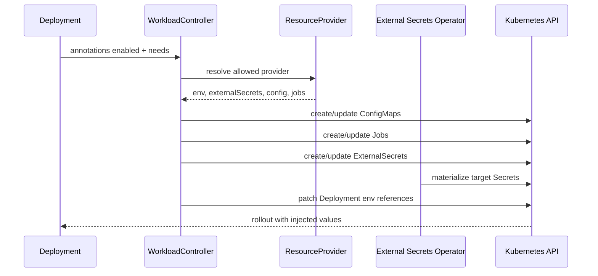
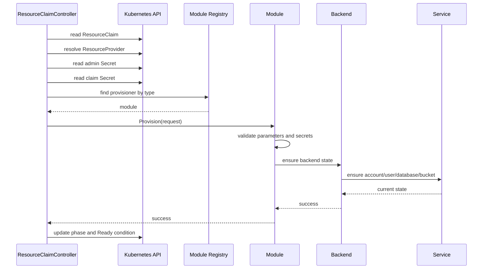
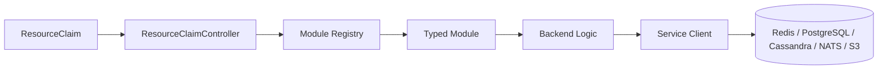

# Eclipse XFSC Kubernetes Operator

The operator has two independent flows: workload injection through `ResourceProvider.outputs`, and backend provisioning through `ResourceClaim` modules.

## Basic Structure

```text
ResourceClaim
        │
        ▼
providerRef / providerSelector
        │
        ▼
ResourceProvider
        │
        ├── type: postgres
        ├── adminSecretRef
        │      namespace: infrastructure
        │      name: postgres-root
        │
        ▼
Provisioner
        │
        ├── reads adminSecretRef
        ├── reads the claim Secret
        ├── connects as administrator
        └── ensures backend resources
```

## Injection flow

A workload opts in with annotations:

```yaml
metadata:
  annotations:
    inject.xfsc.io/enabled: "true"
    inject.xfsc.io/needs: "redis,postgres"
    inject.xfsc.io/env-prefix: "APP"
```

A matching `ResourceProvider` can expose four output types:

- `outputs.env`: fixed environment values.
- `outputs.externalSecrets`: an ESO `ExternalSecret` plus injected `secretKeyRef` variables.
- `outputs.config`: a generated `ConfigMap`; its `env` map injects `configMapKeyRef` variables.
- `outputs.jobs`: rendered `batch/v1 Job` YAML created in the workload namespace.

All generated resources are labelled as operator-managed, tracked per provider, updated idempotently and removed when no longer desired. Jobs are always forced into the target namespace. Templates support `.Namespace`, `.Workload`, `.Type`, `.Provider`, and `.Tenant`.



## Full provider example

See [`examples/provider-full-outputs.yaml`](examples/provider-full-outputs.yaml).

```yaml
outputs:
  env:
    REDIS_HOST: redis.redis.svc.cluster.local
  config:
    - nameTemplate: "{{ .Workload }}-redis-config"
      data:
        redis.conf: "timeout 30"
      env:
        REDIS_CONFIG: redis.conf
  externalSecrets:
    - nameTemplate: "{{ .Workload }}-redis"
      targetSecretNameTemplate: "{{ .Workload }}-redis"
      remoteKeyTemplate: "applications/{{ .Namespace }}/{{ .Workload }}/redis"
      secretStoreRef:
        kind: ClusterSecretStore
        name: openbao
      data:
        - envName: REDIS_USERNAME
          property: username
  jobs:
    - nameTemplate: "{{ .Workload }}-bootstrap"
      yaml: |
        apiVersion: batch/v1
        kind: Job
        metadata:
          name: bootstrap
        spec:
          template:
            spec:
              restartPolicy: OnFailure
              containers:
                - name: bootstrap
                  image: busybox
                  command: ["true"]
```

## ResourceClaims

A `ResourceClaim` is a namespaced request for a backend resource such as a PostgreSQL database and user, a Cassandra keyspace and role, a NATS account or user, a Redis user, or an S3 bucket and credentials. The claim contains the desired backend-specific parameters and references a Secret in the same namespace that is used as the claim's credential contract.

The controller resolves a compatible cluster-scoped `ResourceProvider`, reads its administrator Secret, and delegates reconciliation to the module registered for `spec.type`. Provisioning is idempotent: the module ensures that the requested backend objects exist and updates the claim status instead of creating duplicate resources on every reconciliation.

### ResourceClaim fields

| Field | Required | Description |
| --- | --- | --- |
| `spec.type` | yes | Backend module type. It must match the selected provider's `spec.type`. |
| `spec.providerRef.name` | conditional | Selects one `ResourceProvider` explicitly by name. |
| `spec.providerSelector` | conditional | Selects a provider by Kubernetes labels. Use either `providerRef` or `providerSelector`. |
| `spec.parameters` | module-specific | Raw backend-specific configuration passed to the selected provisioner module. |
| `spec.externalSecretRef.name` | yes | Name of the ExternalSecret in the same namespace as the `ResourceClaim`. The operator reads its target Secret and remote OpenBao key. |

`ResourceClaim` is namespaced and has the short name `rc`. `ResourceProvider` is cluster-scoped, so one provider can serve multiple namespaces when its allow rules permit them.

### Provider selection

A claim can bind to a provider in one of two ways.

Explicit provider reference:

```yaml
spec:
  type: postgres
  providerRef:
    name: postgres-standard
```

Label-based provider selection:

```yaml
spec:
  type: postgres
  providerSelector:
    matchLabels:
      resources.xfsc.io/class: standard
```

The selected provider must:

1. have the same `spec.type` as the claim;
2. allow the claim namespace through `spec.allow.namespaces` or `spec.allow.selector`;
3. define a valid `spec.adminSecretRef` for provisioning modules that require administrator access.

Use an explicit `providerRef` when provider choice must be deterministic. A selector is useful for platform classes such as `standard`, `ha`, or `development`, but its labels should identify exactly one eligible provider.

### Claim Secret

The claim references a Helm/Argo-managed ExternalSecret through `spec.externalSecretRef.name`:

```yaml
apiVersion: v1
kind: Secret
metadata:
  name: database
  namespace: wallet
type: Opaque
stringData:
  username: wallet
  password: replace-me
```

The Secret must exist in the claim namespace before reconciliation can succeed. Its required keys depend on the selected module. The controller reads this Secret together with the provider's administrator Secret; it does not use a cross-namespace reference for the claim Secret.

The field is named `externalSecretRef`, not `secretName`:

```yaml
spec:
  externalSecretRef:
    name: database
```

### Complete PostgreSQL example

Provider managed by the platform team:

```yaml
apiVersion: resources.xfsc.io/v1alpha1
kind: ResourceProvider
metadata:
  name: postgres-standard
  labels:
    resources.xfsc.io/class: standard
spec:
  type: postgres
  description: Shared PostgreSQL service
  allow:
    namespaces:
      - wallet
  adminSecretRef:
    name: postgres-root
    namespace: infrastructure
```

Claim Secret managed in the application namespace:

```yaml
apiVersion: v1
kind: Secret
metadata:
  name: database
  namespace: wallet
type: Opaque
stringData:
  username: wallet
  password: replace-me
```

Application claim:

```yaml
apiVersion: resources.xfsc.io/v1alpha1
kind: ResourceClaim
metadata:
  name: wallet-database
  namespace: wallet
spec:
  type: postgres
  providerSelector:
    matchLabels:
      resources.xfsc.io/class: standard
  externalSecretRef:
    name: database
  parameters:
    database: wallet
    username: wallet
```

Apply the resources and inspect the result:

```bash
kubectl apply -f postgres-provider.yaml
kubectl apply -f postgres-secret.yaml
kubectl apply -f postgres-claim.yaml

kubectl get resourceclaims -n wallet
kubectl describe resourceclaim wallet-database -n wallet
kubectl get resourceclaim wallet-database -n wallet -o yaml
```

The status exposes the observed generation, resolved provider, claim Secret, phase, and Kubernetes conditions:

```yaml
status:
  observedGeneration: 1
  phase: Ready
  providerRef: postgres-standard
  externalSecretRef:
    name: database
  conditions:
    - type: Ready
      status: "True"
```

Treat the condition with `type: Ready` and `status: "True"` as the authoritative success signal. When reconciliation fails, inspect the condition message and the operator logs:

```bash
kubectl describe resourceclaim wallet-database -n wallet
kubectl logs -n <operator-namespace> deployment/<operator-deployment>
```

### Lifecycle and ownership

Deleting a `ResourceClaim` removes the Kubernetes request. Backend cleanup depends on the implementation of the selected module and should not be assumed unless the module explicitly documents deprovisioning behavior. Application charts should therefore treat backend deletion as an operationally significant action.

The provider administrator Secret belongs to the platform namespace and must only be readable by the operator. The claim Secret belongs to the application namespace and should be limited to the operator and the workloads that need the resulting credentials.

## Provisioning flow

`ResourceClaimController` reads the claim, resolves a provider, reads the claim Secret and the provider administrator Secret, and then calls the module selected by `spec.type`.





## Developer tests

Run formatting and unit tests:

```bash
gofmt -w api cmd internal
go test ./...
```

Run the module service environment:

```bash
docker compose -f test/integration/docker-compose.yaml up -d --wait
XFSC_INTEGRATION=1 go test -tags=integration ./internal/modules/...
docker compose -f test/integration/docker-compose.yaml down -v
```

Manual verification commands and service ports are documented in [`test/integration/README.md`](test/integration/README.md).

Validate examples and Helm manifests:

```bash
kubectl apply --dry-run=client -f examples/provider-full-outputs.yaml
helm lint deployment/helm
helm template xfsc-operator deployment/helm >/tmp/xfsc-operator.yaml
```

## Existing examples

- `examples/redis-provider.yaml`: Redis injection provider.
- `examples/provider-full-outputs.yaml`: env, ExternalSecret, ConfigMap and Job outputs.
- `examples/workload.yaml`: workload opt-in.
- `examples/*-claim.yaml`: resource provisioning claims.
- `examples/rendered-externalsecret.yaml`: expected ESO output.

## ExternalSecret-backed ResourceClaims

`ResourceClaim.spec.externalSecretRef.name` references an `ExternalSecret` rendered by Helm/Argo in the same namespace. The operator:

1. reads `ExternalSecret.spec.target.name` and `spec.data[].remoteRef.key`,
2. authenticates to OpenBao with its Kubernetes service account,
3. derives the KV-v2 engine from the first segment of `remoteRef.key` and ensures it exists,
4. creates `username` and `password` once at the referenced remote key,
5. waits for ESO to create the target Kubernetes Secret,
6. provisions or updates the backend account from that Secret,
7. watches both the ExternalSecret and its target Secret,
8. removes the OpenBao path when the claim is deleted.

Helm/Argo owns the ResourceClaim and ExternalSecret. OpenBao owns the credential values, ESO owns the generated Kubernetes Secret, and the resource operator owns backend reconciliation.

The remote key must follow `<engine>/<secret-path>`, for example `infrastructure/cassandra/tenant-a`. Required operator connection and authentication values are configured through the Helm values under `openbao`; no separate KV engine value is required.
